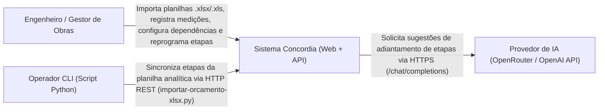
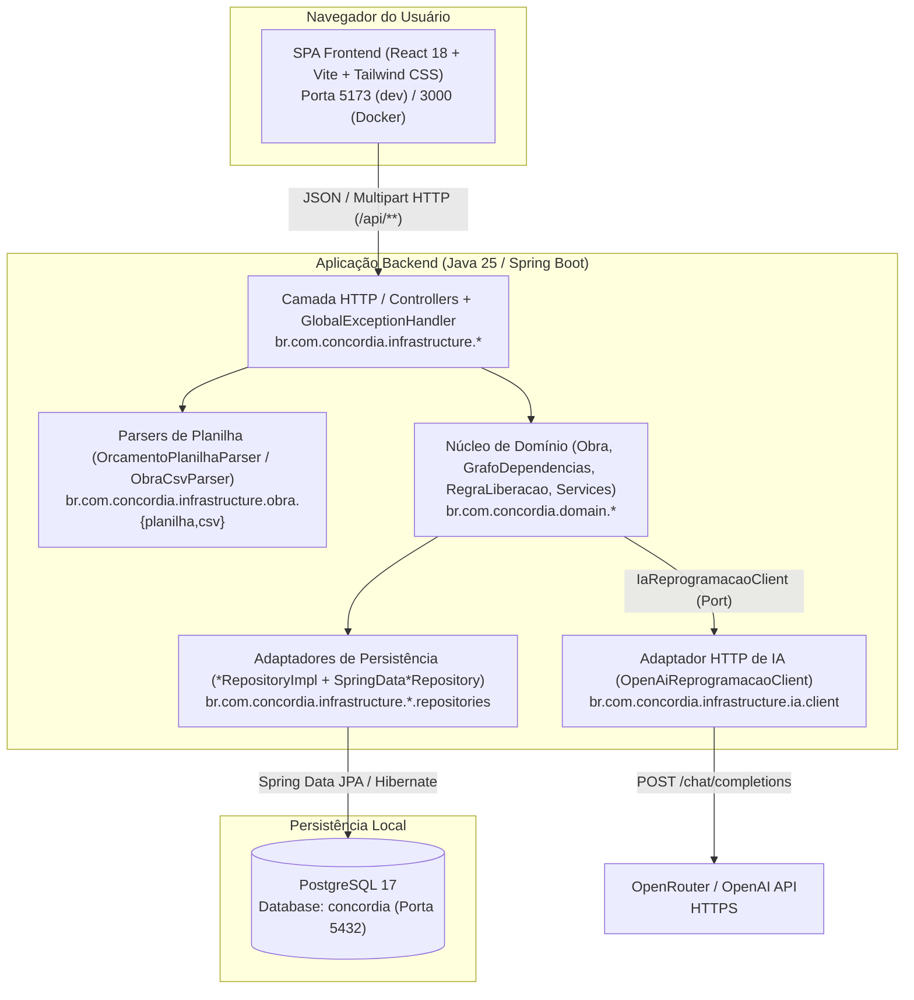
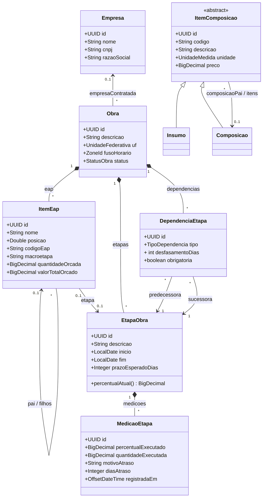

# Visão de Arquitetura — Concordia

## 1. Introdução e Objetivos

O **Concordia** é uma plataforma de gestão de obras, orçamentos analíticos/sintéticos e acompanhamento físico-financeiro que transforma planilhas orçamentárias (SINAPI e Estruturas Analíticas de Projeto — EAP) em uma trilha de execução interativa, tátil e orientada por dependências construtivas (`FI`, `II`, `FF`), com suporte a reprogramação assistida por Inteligência Artificial.

### Atributos de Qualidade Prioritários

| Prioridade | Atributo de Qualidade | Cenário Concreto no Sistema |
| --- | --- | --- |
| 1 | **Integridade de Domínio e Consistência Financeira** | Toda importação de planilha (`UC-OBR-001`), reordenação de trilha (`UC-OBR-005`) e alteração de dependências (`UC-OBR-006`) executa em transação ACID, com aritmética monetária em `BigDecimal` e validação de invariantes no domínio. |
| 2 | **Resiliência e Degradação Elegante (Graceful Degradation)** | A análise de atraso (`UC-OBR-004`) opera mesmo sem conectividade externa ou sem chave de API da OpenRouter/OpenAI, recorrendo automaticamente ao algoritmo determinístico local (`RN-OBR-003`). |
| 3 | **Usabilidade em Campo e Clareza Visual** | A interface web traduz a árvore da EAP e o grafo de dependências em uma trilha visual estilo Duolingo (`TimelinePage`), com componentes estruturados em Atomic Design. |
| 4 | **Rastreabilidade Contratual** | Os contratos HTTP entre `api/` e `web/` seguem a especificação OpenAPI 3.1 (`api/openapi.yaml`), com geração automatizada do cliente TypeScript via Orval (`web/orval.config.ts`) e erros estruturados segundo a RFC 7807 (`ProblemDetail`). |

---

## 2. Restrições Arquiteturais

| Restrição | Descrição |
| --- | --- |
| **Stack Backend** | Java 25, Spring Boot 4.1.1, Spring Data JPA / Hibernate, Spring Security, Bean Validation, MapStruct 1.6.3, Apache POI (`poi-ooxml` 5.4.1) e PostgreSQL 17 (`postgres:17-alpine`). |
| **Stack Frontend** | React 18.3, TypeScript 5.7, Vite 6.0, Tailwind CSS puro (sem Radix/shadcn), Lucide React, React Router v6, TanStack Query v5, Orval 8.2 e Storybook 10.6. |
| **Isolamento de Pacotes** | Separação explícita entre `br.com.concordia.domain.*` (entidades, serviços de domínio, portas de saída, interfaces de repositório e objetos de valor) e `br.com.concordia.infrastructure.*` (controllers REST, DTOs, mappers de infraestrutura, parsers POI/CSV, implementações de repositório Spring Data e adaptadores HTTP externos). |

---

## 3. Contexto do Sistema (C4 Nível 1)

---

## 4. Visão de Containers e Componentes (C4 Nível 2)

### Responsabilidades dos Containers e Módulos

| Container / Módulo | Caminho no Repositório | Responsabilidade Principal |
| --- | --- | --- |
| **SPA Frontend (`web`)** | `web/src/pages/` | Renderiza a página de importação (`ImportarObraPage.tsx`), a trilha gamificada (`TimelinePage.tsx`) e a configuração de dependências (`DependenciasPage.tsx`), gerenciando cache assíncrono com TanStack Query. |
| **Design System (`web`)** | `web/src/components/` e `web/src/system-design/` | Biblioteca de componentes reutilizáveis (`atoms/`, `molecules/`, `organisms/`, `templates/`) documentada e testada no Storybook (`SystemDesignOverview.stories.tsx`). |
| **Infraestrutura HTTP & Parsers (`api`)** | `api/src/main/java/br/com/concordia/infrastructure/` | Recebe requisições REST, valida DTOs, converte planilhas `.xlsx`/`.xls`/`.csv`, padroniza erros em `ProblemDetail` (`GlobalExceptionHandler`) e implementa portas de repositório e de IA (`OpenAiReprogramacaoClient`). |
| **Domínio (`api`)** | `api/src/main/java/br/com/concordia/domain/` | Concentra as entidades (`Obra`, `ItemEap`, `EtapaObra`, `MedicaoEtapa`, `DependenciaEtapa`, `ItemOrcamento`, `Composicao`, `ItemComposicao`, `Insumo`, `Empresa`), algoritmos de grafo (`GrafoDependencias`, `RegraLiberacao`) e serviços transacionais. |
| **Banco Relacional (`postgres`)** | `compose.yaml` e `api/src/main/resources/db/migration/` | Armazena entidades transacionais do catálogo, empresas, obras, árvore da EAP, etapas, medições e grafo de dependências. |

---

## 5. Modelo Estrutural de Entidades do Domínio

O diagrama abaixo reflete o modelo implementado em `api/src/main/java/br/com/concordia/domain/` (alinhado com `api/docs/entidades.mmd`):

---

## 6. Conceitos Transversais (Cross-Cutting Concerns)

1. **Tratamento Padronizado de Erros (RFC 7807 Problem Details):**
   - `GlobalExceptionHandler` (`api/src/main/java/br/com/concordia/infrastructure/common/interceptors/GlobalExceptionHandler.java`) intercepta exceções de domínio e validação e produz respostas JSON `ProblemDetail`:
     - `MethodArgumentNotValidException` → `400 Bad Request` (`title: "Erro de Validação de Dados"`, propriedade `invalidFields`).
     - `IllegalArgumentException` → `400 Bad Request` (`title: "Requisição Inválida"`).
     - `EntityNotFoundException` → `404 Not Found` (`title: "Recurso Não Encontrado"`).
     - `ConflitoException` → `409 Conflict` (`title: "Conflito"`).
     - `PlanilhaInvalidaException` → `422 Unprocessable Content` (`title: "Planilha Inválida"`, propriedade `erros`).
     - `MaxUploadSizeExceededException` → `413 Content Too Large` (`title: "Arquivo Muito Grande"`).
   - No frontend, `ensureOk` e `problemMessage` (`web/src/services/apiProblem.ts`) decodificam `ProblemDetail` em `ApiProblemError` para exibição estruturada nos componentes de UI.
2. **Segurança e CORS:**
   - `SecurityConfig` (`api/src/main/java/br/com/concordia/infrastructure/common/configs/SecurityConfig.java`) desabilita CSRF para a API stateless e libera `permitAll()` nas rotas REST na configuração atual.
3. **Documentação Viva da API e de Componentes:**
   - Especificação OpenAPI 3.1 gerada e sincronizada em `api/openapi.yaml` (Swagger UI em `/swagger` no perfil `dev`).
   - Catálogo de componentes Atomic Design mantido no Storybook (`web/src/system-design/SystemDesignOverview.stories.tsx`) com suporte ao servidor MCP em `http://localhost:6006/mcp`.

---

## 7. Decisões Arquiteturais (ADRs)

- [ADR-001 — Separação entre Domínio e Infraestrutura com Ports & Adapters](../adr/ADR-001-separacao-dominio-infraestrutura-ports-adapters.md)
- [ADR-002 — Reprogramação Assistida por IA com Fallback Determinístico Local](../adr/ADR-002-reprogramacao-assistida-por-ia-com-fallback-local.md)
- [ADR-003 — Trilha Gamificada em Atomic Design e Cliente HTTP Tipado por OpenAPI](../adr/ADR-003-trilha-gamificada-atomic-design-cliente-openapi.md)
- [ADR-004 — Modelagem de Grafo de Dependências Construtivas (DAG) e Reordenação Fracionária](../adr/ADR-004-modelagem-grafo-dependencias-eap.md)

---

## 8. Riscos e Dívidas Técnicas Arquiteturais

| Risco / Dívida Técnica | Impacto | Mitigação Atual / Planejada |
| --- | --- | --- |
| **Autenticação aberta (`permitAll`) em `SecurityConfig`** | Qualquer cliente com acesso de rede à porta `8080` pode modificar dados de obras e catálogos. | Restrito atualmente a ambientes locais/homologação; planejada introdução de autenticação e controle de acesso por empresa. |
| **Chamada HTTP externa para IA dentro de `@Transactional(readOnly = true)`** | Em `SugestaoAdiantamentoService.analisarAtraso()`, a transação de leitura permanece aberta durante a chamada ao `OpenAiReprogramacaoClient` (timeout de até 30s). | Separar a leitura de dados da obra/etapas da chamada HTTP externa a `IaReprogramacaoClient`. |
