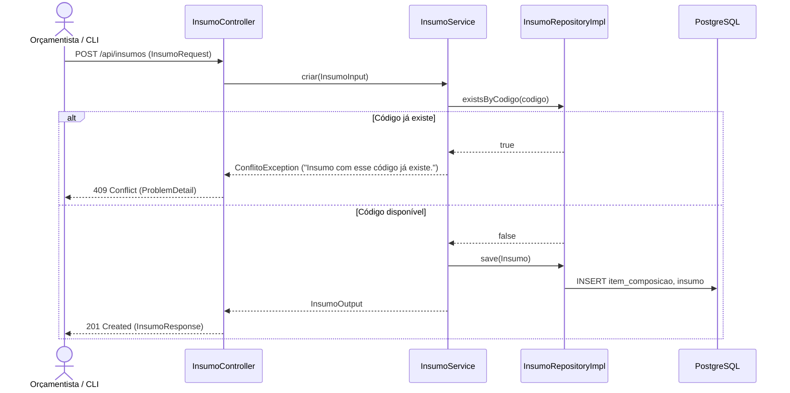

# Implementação Técnica — UC-CAT-001 (Gerenciar Catálogo de Insumos)

## 1. Pontos de Entrada e Participantes

| Camada / Papel | Caminho do Arquivo | Símbolo Principal | Responsabilidade no Fluxo |
| --- | --- | --- | --- |
| Entrada REST (Controller) | `api/src/main/java/br/com/concordia/infrastructure/insumo/InsumoController.java` | `InsumoController.criar()`, `consultar()`, `atualizar()`, `atualizarParcial()`, `deletar()`, `listar()` | Endpoints REST em `/api/insumos` |
| DTOs e Mapper de Infraestrutura | `api/src/main/java/br/com/concordia/infrastructure/insumo/dtos/InsumoRequest.java`, `api/src/main/java/br/com/concordia/infrastructure/insumo/dtos/InsumoParcialRequest.java`, `api/src/main/java/br/com/concordia/infrastructure/insumo/dtos/InsumoResponse.java`, `api/src/main/java/br/com/concordia/infrastructure/insumo/InsumoInfraMapper.java` | `InsumoRequest`, `InsumoParcialRequest`, `InsumoResponse`, `InsumoInfraMapper` | Validação Bean Validation (`@NotBlank`, `@Size`, `@Positive`, `@Digits`) e mapeamento HTTP |
| Aplicação / Domínio | `api/src/main/java/br/com/concordia/domain/insumo/InsumoService.java`, `api/src/main/java/br/com/concordia/domain/insumo/InsumoMapper.java` | `InsumoService.criar()`, `consultar()`, `atualizar()`, `atualizarParcial()`, `deletar()`, `listar()` | Verifica duplicidade de código (`repository.existsByCodigo`) e gerencia o ciclo de vida de `Insumo` |
| Entidades e Repositórios | `api/src/main/java/br/com/concordia/domain/insumo/Insumo.java`, `api/src/main/java/br/com/concordia/domain/composicao/entities/ItemComposicao.java`, `api/src/main/java/br/com/concordia/domain/insumo/InsumoRepository.java`, `api/src/main/java/br/com/concordia/infrastructure/insumo/repositories/InsumoRepositoryImpl.java`, `api/src/main/java/br/com/concordia/infrastructure/insumo/repositories/SpringDataInsumoRepository.java` | `Insumo`, `ItemComposicao`, `InsumoRepositoryImpl` | Persistência JPA com herança `InheritanceType.JOINED` nas tabelas `item_composicao` e `insumo` |
| Cliente HTTP Gerado | `web/src/api/generated/insumos/insumos.ts` | `criar2()`, `consultar2()`, `atualizar2()`, `atualizarParcial2()`, `deletar2()`, `listar2()` | Funções e hooks gerados pelo Orval para `/api/insumos` |

## 2. Percurso Técnico, Transações e Eventos

1. **Entrada e Contrato:**
   - `POST /api/insumos` → `201 Created` (`InsumoResponse`)
   - `GET /api/insumos` → `200 OK` (`List<InsumoResponse>`)
   - `GET /api/insumos/{id}` → `200 OK` (`InsumoResponse`)
   - `PUT /api/insumos/{id}` → `200 OK` (`InsumoResponse`)
   - `PATCH /api/insumos/{id}` → `200 OK` (`InsumoResponse`)
   - `DELETE /api/insumos/{id}` → `204 No Content`
2. **Controle Transacional e Persistência:**
   - Todos os métodos de escrita de `InsumoService` executam sob `@Transactional`, enquanto `consultar()` e `listar()` utilizam `@Transactional(readOnly = true)`.
   - `Insumo` herda de `ItemComposicao` (`@Inheritance(strategy = InheritanceType.JOINED)`), armazenando `id`, `codigo`, `descricao`, `unidade`, `preco` e `id_composicao_pai` na tabela `item_composicao` e a chave primária especializada na tabela `insumo`.

## 3. Guardrails e Restrições Técnicas (O que NÃO fazer)

- **Unicidade de `codigo` na Tabela Base:** A coluna `codigo` em `item_composicao` possui `unique = true`. Em atualizações (`PUT` / `PATCH`) que alterem `codigo`, garanta que o novo código não colida com outro `ItemComposicao` existente.

## 4. Diagramas

## 5. Rastreabilidade de Testes Automatizados

Não há suíte de testes unitários ou de integração dedicada exclusivamente a `InsumoService` ou `InsumoController` no repositório atual.
