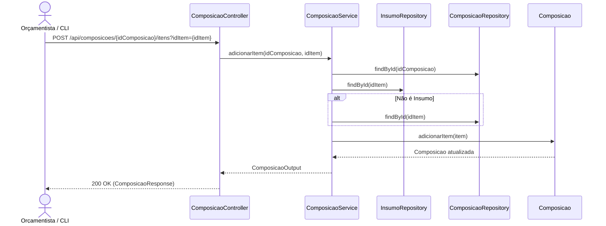

# Implementação Técnica — UC-CAT-002 (Gerenciar Composições de Custos e Seus Itens)

## 1. Pontos de Entrada e Participantes

| Camada / Papel | Caminho do Arquivo | Símbolo Principal | Responsabilidade no Fluxo |
| --- | --- | --- | --- |
| Entrada REST (Controller) | `api/src/main/java/br/com/concordia/infrastructure/composicao/ComposicaoController.java` | `ComposicaoController.criar()`, `consultar()`, `atualizar()`, `atualizarParcial()`, `deletar()`, `listar()`, `adicionarItem()`, `deletarItem()` | Endpoints REST em `/api/composicoes` e `/api/composicoes/{idComposicao}/itens` |
| DTOs e Mapper de Infraestrutura | `api/src/main/java/br/com/concordia/infrastructure/composicao/dtos/ComposicaoRequest.java`, `api/src/main/java/br/com/concordia/infrastructure/composicao/dtos/ComposicaoParcialRequest.java`, `api/src/main/java/br/com/concordia/infrastructure/composicao/dtos/ComposicaoResponse.java`, `api/src/main/java/br/com/concordia/infrastructure/composicao/ComposicaoInfraMapper.java` | `ComposicaoRequest`, `ComposicaoParcialRequest`, `ComposicaoResponse`, `ComposicaoInfraMapper` | Validação de entrada e serialização de saída |
| Aplicação / Domínio | `api/src/main/java/br/com/concordia/domain/composicao/ComposicaoService.java`, `api/src/main/java/br/com/concordia/domain/composicao/ComposicaoMapper.java` | `ComposicaoService.criar()`, `consultar()`, `atualizar()`, `atualizarParcial()`, `deletar()`, `listar()`, `adicionarItem()`, `deletarItem()`, `findItemComposicao()` | Gerencia `Composicao` e resolve itens filhos em `InsumoRepository` e `ComposicaoRepository` |
| Entidades e Repositórios | `api/src/main/java/br/com/concordia/domain/composicao/entities/Composicao.java`, `api/src/main/java/br/com/concordia/domain/composicao/entities/ItemComposicao.java`, `api/src/main/java/br/com/concordia/domain/composicao/ComposicaoRepository.java`, `api/src/main/java/br/com/concordia/infrastructure/composicao/repositories/ComposicaoRepositoryImpl.java` | `Composicao`, `ItemComposicao`, `ComposicaoRepositoryImpl` | Implementam o *Composite Pattern* JPA nas tabelas `item_composicao` e `composicao` |
| Automação CLI | `api/scripts/importar-orcamento-xlsx.py` | `sincronizar()`, `extrair_composicoes()` | Script Python que lê composições de planilhas `.xlsx` e sincroniza via `GET`/`POST`/`PUT` em `/api/composicoes` |
| Cliente HTTP Gerado | `web/src/api/generated/composições/composições.ts` | `criar4()`, `consultar4()`, `atualizar4()`, `atualizarParcial4()`, `deletar4()`, `listar4()`, `adicionarItem()`, `deletarItem()` | Funções e hooks gerados pelo Orval |

## 2. Percurso Técnico, Transações e Eventos

1. **Entrada e Contrato:**
   - `POST /api/composicoes` → `201 Created` (`ComposicaoResponse`)
   - `GET /api/composicoes` → `200 OK` (`List<ComposicaoResponse>`)
   - `GET /api/composicoes/{id}` → `200 OK` (`ComposicaoResponse`)
   - `PUT /api/composicoes/{id}` → `200 OK` (`ComposicaoResponse`)
   - `PATCH /api/composicoes/{id}` → `200 OK` (`ComposicaoResponse`)
   - `DELETE /api/composicoes/{id}` → `204 No Content`
   - `POST /api/composicoes/{idComposicao}/itens?idItem={uuid}` → `200 OK` (`ComposicaoResponse`)
   - `DELETE /api/composicoes/{idComposicao}/itens?idItem={uuid}` → `204 No Content`
2. **Controle Transacional e Persistência:**
   - Em `ComposicaoService.adicionarItem(idComposicao, idItem)`, `findItemComposicao(idItem)` consulta primeiro `insumoRepository.findById(id)` e depois `repository.findById(id)`. Ao chamar `composicao.adicionarItem(item)`, a entidade verifica `!this.itens.contains(item)`, adiciona à coleção `itens` e define `item.setComposicaoPai(this)`.

## 3. Guardrails e Restrições Técnicas (O que NÃO fazer)

- **Manutenção Bidirecional de `composicaoPai`:** Sempre utilize `Composicao.adicionarItem()` e `Composicao.removerItem()` para manipular os itens filhos, pois o lado proprietário da chave estrangeira `id_composicao_pai` está em `ItemComposicao.composicaoPai`.

## 4. Diagramas

## 5. Rastreabilidade de Testes Automatizados

Não há suíte de testes unitários ou de integração dedicada exclusivamente a `ComposicaoService` ou `ComposicaoController` no repositório atual.
