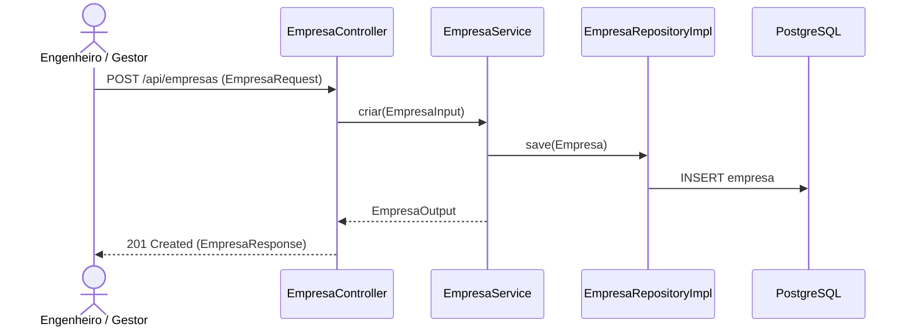

# Implementação Técnica — UC-EMP-001 (Gerenciar Cadastro de Empresas Contratadas)

## 1. Pontos de Entrada e Participantes

| Camada / Papel | Caminho do Arquivo | Símbolo Principal | Responsabilidade no Fluxo |
| --- | --- | --- | --- |
| Entrada REST (Controller) | `api/src/main/java/br/com/concordia/infrastructure/empresa/EmpresaController.java` | `EmpresaController.criar()`, `consultar()`, `atualizar()`, `atualizarParcial()`, `deletar()`, `listar()` | Endpoints REST em `/api/empresas` |
| DTOs e Mapper de Infraestrutura | `api/src/main/java/br/com/concordia/infrastructure/empresa/dtos/EmpresaRequest.java`, `api/src/main/java/br/com/concordia/infrastructure/empresa/dtos/EmpresaParcialRequest.java`, `api/src/main/java/br/com/concordia/infrastructure/empresa/dtos/EmpresaResponse.java`, `api/src/main/java/br/com/concordia/infrastructure/empresa/EmpresaInfraMapper.java` | `EmpresaRequest`, `EmpresaParcialRequest`, `EmpresaResponse`, `EmpresaInfraMapper` | Validação Bean Validation (`@NotBlank`, `@Size`, `@CNPJ`) e mapeamento HTTP |
| Aplicação / Domínio | `api/src/main/java/br/com/concordia/domain/empresa/EmpresaService.java`, `api/src/main/java/br/com/concordia/domain/empresa/EmpresaMapper.java` | `EmpresaService.criar()`, `consultar()`, `atualizar()`, `atualizarParcial()`, `deletar()`, `listar()` | Coordenação transacional do ciclo de vida de `Empresa` |
| Entidade e Repositório | `api/src/main/java/br/com/concordia/domain/empresa/entities/Empresa.java`, `api/src/main/java/br/com/concordia/domain/empresa/EmpresaRepository.java`, `api/src/main/java/br/com/concordia/infrastructure/empresa/repositories/EmpresaRepositoryImpl.java`, `api/src/main/java/br/com/concordia/infrastructure/empresa/repositories/SpringDataEmpresaRepository.java` | `Empresa`, `EmpresaRepositoryImpl` | Persistência JPA na tabela `empresa` |
| Consumidor Frontend | `web/src/pages/ImportarObraPage.tsx`, `web/src/api/generated/empresas/empresas.ts` | `useListar3()` | Carrega a lista de empresas para seleção opcional na etapa de revisão da importação |

## 2. Percurso Técnico, Transações e Eventos

1. **Entrada e Contrato:**
   - `POST /api/empresas` → `201 Created` (`EmpresaResponse`)
   - `GET /api/empresas` → `200 OK` (`List<EmpresaResponse>`)
   - `GET /api/empresas/{id}` → `200 OK` (`EmpresaResponse`)
   - `PUT /api/empresas/{id}` → `200 OK` (`EmpresaResponse`)
   - `PATCH /api/empresas/{id}` → `200 OK` (`EmpresaResponse`)
   - `DELETE /api/empresas/{id}` → `204 No Content`
2. **Controle Transacional e Persistência:**
   - `EmpresaService` executa operações de escrita sob `@Transactional` e consultas sob `@Transactional(readOnly = true)`, delegando a `EmpresaRepositoryImpl`.

## 3. Guardrails e Restrições Técnicas (O que NÃO fazer)

- **Unicidade de CNPJ:** A coluna `cnpj` na entidade `Empresa` possui `unique = true`. Não remova a anotação `@CNPJ` de `EmpresaRequest` e `EmpresaParcialRequest`.

## 4. Diagramas

## 5. Rastreabilidade de Testes Automatizados

- `web/tests/e2e/importacao.spec.ts` (`setupApi` simula `GET /api/empresas` durante o fluxo E2E de importação de obra).
- Não há suíte de testes unitários dedicada exclusivamente a `EmpresaService` ou `EmpresaController`.
