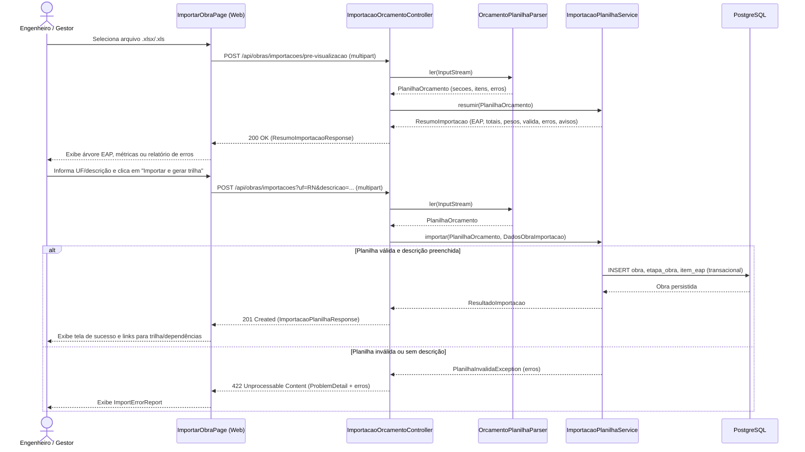

# Implementação Técnica — UC-OBR-001 (Importar Planilha Orçamentária Excel)

## 1. Pontos de Entrada e Participantes

| Camada / Papel | Caminho do Arquivo | Símbolo Principal | Responsabilidade no Fluxo |
| --- | --- | --- | --- |
| Entrada UI (Página) | `web/src/pages/ImportarObraPage.tsx` | `ImportarObraPage` | Conduz o assistente de 3 passos (upload, revisão da EAP com formulário de dados da obra e tela de sucesso) |
| Componentes UI | `web/src/components/molecules/FileDropzone/FileDropzone.tsx`, `web/src/components/organisms/ImportPreviewPanel/ImportPreviewPanel.tsx`, `web/src/components/organisms/EapTree/EapTree.tsx`, `web/src/components/molecules/ImportErrorReport/ImportErrorReport.tsx` | `FileDropzone`, `ImportPreviewPanel`, `EapTree`, `ImportErrorReport` | Seleção/validação de extensão `.xlsx`/`.xls`, exibição de métricas, árvore interativa da EAP e tabela de erros por linha/coluna |
| Cliente HTTP Gerado | `web/src/api/generated/importação-de-orçamento/importação-de-orçamento.ts`, `web/src/services/apiProblem.ts` | `preVisualizarPlanilha()`, `importarPlanilha()`, `ensureOk()` | Envia `multipart/form-data` para a API e converte respostas HTTP 4xx/422 em `ApiProblemError` |
| Entrada REST (Controller) | `api/src/main/java/br/com/concordia/infrastructure/obra/ImportacaoOrcamentoController.java` | `ImportacaoOrcamentoController.preVisualizar()`, `ImportacaoOrcamentoController.importar()` | Recebe o `MultipartFile`, valida presença/extensão e fuso horário e delega ao parser e ao serviço de domínio |
| Parser de Infraestrutura | `api/src/main/java/br/com/concordia/infrastructure/obra/planilha/OrcamentoPlanilhaParser.java` | `OrcamentoPlanilhaParser.ler()` | Abre a planilha via Apache POI (`WorkbookFactory.create`) e extrai seções, itens, cabeçalho e erros de leitura |
| Aplicação / Domínio | `api/src/main/java/br/com/concordia/domain/obra/importacao/ImportacaoPlanilhaService.java` | `ImportacaoPlanilhaService.resumir()`, `ImportacaoPlanilhaService.importar()` | Monta a árvore da EAP, aplica `RN-OBR-001`, `RN-OBR-001-01` e `RN-OBR-001-02`, calcula pesos e persiste a `Obra` |
| Entidades e Persistência | `api/src/main/java/br/com/concordia/domain/obra/entities/Obra.java`, `api/src/main/java/br/com/concordia/domain/obra/entities/ItemEap.java`, `api/src/main/java/br/com/concordia/domain/obra/entities/EtapaObra.java`, `api/src/main/java/br/com/concordia/infrastructure/obra/repositories/ObraRepositoryImpl.java` | `Obra`, `ItemEap`, `EtapaObra`, `ObraRepositoryImpl.save()` | Persiste em cascata a obra, a árvore de `ItemEap` e as `EtapaObra` nas tabelas `obra`, `item_eap` e `etapa_obra` |
| Tratamento de Exceções | `api/src/main/java/br/com/concordia/infrastructure/common/interceptors/GlobalExceptionHandler.java` | `GlobalExceptionHandler.handlePlanilhaInvalida()` | Converte `PlanilhaInvalidaException` em `ProblemDetail` HTTP `422 Unprocessable Content` contendo a propriedade `erros` |

## 2. Percurso Técnico, Transações e Eventos

1. **Entrada e Contrato:**
   - Pré-visualização: `POST /api/obras/importacoes/pre-visualizacao` (`multipart/form-data` com parte `arquivo`). Responde sempre `200 OK` quando o arquivo possui extensão `.xlsx`/`.xls` e tamanho até 20 MB, mesmo que a planilha possua erros de estrutura ou conteúdo (indicados por `valida: false` e lista `erros` em `ResumoImportacaoResponse`).
   - Importação: `POST /api/obras/importacoes` (`multipart/form-data` com parte `arquivo` e query params `descricao`, `uf`, `fusoHorario` com padrão `America/Sao_Paulo` e `idEmpresa` opcional).
2. **Controle Transacional e Persistência:**
   - `ImportacaoPlanilhaService.resumir()` executa exclusivamente em memória, sem abrir transação nem acessar o banco.
   - `ImportacaoPlanilhaService.importar()` é anotado com `@Transactional`. Ele reconstrói e valida a árvore a partir do arquivo enviado, consulta `EmpresaRepository.findById()` se `idEmpresa` for informado, instancia `Obra` com `StatusObra.EM_PLANEJAMENTO`, percorre recursivamente as raízes em pré-ordem atribuindo posições múltiplas de `1000.0` (`ImportacaoPlanilhaService.persistir()`) e executa `obraRepository.save(obra)`. Graças ao `CascadeType.ALL` em `Obra.etapas` e `Obra.eap`, todos os registros de `EtapaObra` e `ItemEap` são gravados na mesma transação.
3. **Eventos e Processamento Assíncrono:**
   - O processamento ocorre de forma integralmente síncrona na requisição HTTP. No frontend, após o sucesso da mutação de importação, `ImportarObraPage` invalida a query `getListarQueryKey()` do TanStack Query para atualizar a listagem de obras.
4. **Tratamento de Falhas e Retentativas:**
   - Arquivo ausente, vazio, com extensão diferente de `.xlsx`/`.xls` ou `fusoHorario` inválido lança `IllegalArgumentException`, traduzido por `GlobalExceptionHandler.handleIllegalArgument()` em HTTP `400 Bad Request`.
   - Upload acima de 20 MB lança `MaxUploadSizeExceededException`, traduzido em HTTP `413 Content Too Large`.
   - Planilha com `erros` de validação ou sem descrição da obra lança `PlanilhaInvalidaException`, traduzido em HTTP `422 Unprocessable Content` com a lista estruturada `erros` (`linha`, `coluna`, `mensagem`).

## 3. Guardrails e Restrições Técnicas (O que NÃO fazer)

- **Isolamento de Apache POI na Infraestrutura:** Nunca vaze tipos do Apache POI (`Workbook`, `Sheet`, `Row`, `Cell`) para o pacote `br.com.concordia.domain`. `OrcamentoPlanilhaParser` deve sempre converter a planilha em `PlanilhaOrcamento` (`SecaoPlanilha`, `ItemPlanilha`, `ErroImportacao`) antes de invocar `ImportacaoPlanilhaService`.
- **Acumulação de Erros de Parsing:** Em `OrcamentoPlanilhaParser` e `ImportacaoPlanilhaService.montar()`, nunca interrompa a leitura no primeiro erro de linha/célula lançando exceção imediata; acumule todos os problemas em `List<ErroImportacao>` para que o usuário receba o relatório completo de uma só vez.
- **Unicidade de `(id_obra, codigo_eap)` no Banco:** A migração `V2__dados_orcamentarios_item_eap.sql` define o índice único parcial `uk_item_eap_id_obra_codigo_eap` sobre `item_eap (id_obra, codigo_eap) WHERE codigo_eap IS NOT NULL`. Nunca remova a validação de `codigosUsados` em `ImportacaoPlanilhaService.montar()`, pois ela impede violação de constraint SQL durante o `save` transacional.
- **Adaptação de Erros do Cliente Orval:** No frontend, os clientes gerados pelo Orval resolvem a Promise mesmo para status HTTP 4xx/5xx. Sempre envolva as chamadas `preVisualizarPlanilha` e `importarPlanilha` com `ensureOk()` (`web/src/services/apiProblem.ts`) para que o TanStack Query capture `ApiProblemError` e exiba o `ImportErrorReport`.

## 4. Diagramas

## 5. Rastreabilidade de Testes Automatizados

| Cenário / Regra | Tipo de Teste | Arquivo de Teste | Nome do Teste / Método |
| --- | --- | --- | --- |
| `UC-OBR-001-C01`, `RN-OBR-001-01` | Unitário (Backend) | `api/src/test/java/br/com/concordia/infrastructure/obra/planilha/OrcamentoPlanilhaParserTest.java` | `leAPlanilhaAnaliticaDeExemploDoRepositorio`, `leBlocoAnaliticoMinimo`, `leSinteticaComCabecalhosSinonimosEIgnoraRodape`, `converteNumerosNoPadraoBrasileiro` |
| `UC-OBR-001-C01`, `RN-OBR-001` | Unitário (Backend) | `api/src/test/java/br/com/concordia/domain/obra/importacao/ImportacaoPlanilhaServiceTest.java` | `resumeArvoreCustosEPesos`, `persisteObraComMacroetapasSubetapasEItens`, `usaDescricaoInformadaPeloUsuario` |
| `UC-OBR-001-C02`, `RN-OBR-001-02` | Unitário (Backend) | `api/src/test/java/br/com/concordia/domain/obra/importacao/ImportacaoPlanilhaServiceTest.java` | `cadastraItensSemBancoComoComposicaoPropria` |
| `UC-OBR-001-C03`, `RN-OBR-001-02` | Unitário (Backend) | `api/src/test/java/br/com/concordia/domain/obra/importacao/ImportacaoPlanilhaServiceTest.java` | `avisaQuandoTotalInformadoDivergeDaSomaDosItens` |
| `UC-OBR-001-C05`, `RN-OBR-001-01`, `RN-OBR-001-02` | Unitário (Backend) | `api/src/test/java/br/com/concordia/infrastructure/obra/planilha/OrcamentoPlanilhaParserTest.java` | `relataQuantidadeMalFormatadaComLinhaEColuna`, `relataColunasObrigatoriasAusentes`, `rejeitaArquivoQueNaoEPlanilha`, `rejeitaPlanilhaSemCabecalhoReconhecido` |
| `UC-OBR-001-C05`, `UC-OBR-001-C06`, `RN-OBR-001-02` | Unitário (Backend) | `api/src/test/java/br/com/concordia/domain/obra/importacao/ImportacaoPlanilhaServiceTest.java` | `relataCodigosDuplicados`, `naoPersistePlanilhaComErros`, `exigeDescricaoQuandoPlanilhaNaoTemNomeDaObra` |
| `UC-OBR-001-C01`, `UC-OBR-001-C04`, `UC-OBR-001-C05` | Componente (Frontend) | `web/src/tests/ImportacaoPlanilha.component.test.tsx` | `runTests` (`FileDropzone`, `ImportErrorReport`, `ImportSummaryStats`, `EapTree`, `ImportPreviewPanel`, `ensureOk`) |
| `UC-OBR-001-C01`, `UC-OBR-001-C04`, `UC-OBR-001-C05` | E2E / Acessibilidade (Playwright) | `web/tests/e2e/importacao.spec.ts` | `UC01: valida a planilha, mostra o resumo e importa a obra`, `UC01 (3a): exibe o relatório de erros quando a planilha é inválida`, `UC01: recusa arquivos que não são planilhas Excel sem chamar a API`, `UC01: mostra o relatório devolvido pela API quando a importação responde 422`, `UC01: tela de importação sem violações críticas de acessibilidade` |

Não há teste automatizado de integração HTTP para `UC-OBR-001-C07` (empresa inexistente durante a importação da planilha Excel).
