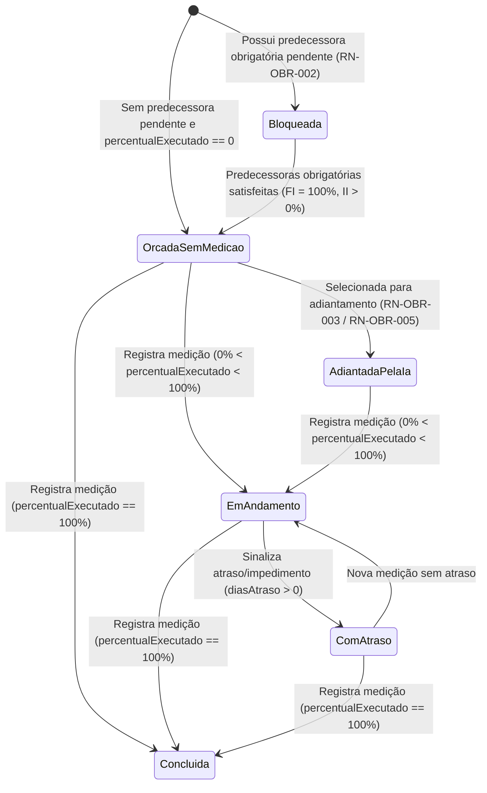

# Implementação Técnica — UC-OBR-002 (Visualizar Trilha Gamificada e Etapas da Obra)

## 1. Pontos de Entrada e Participantes

| Camada / Papel | Caminho do Arquivo | Símbolo Principal | Responsabilidade no Fluxo |
| --- | --- | --- | --- |
| Entrada UI (Página) | `web/src/pages/TimelinePage.tsx` | `TimelinePage` | Consulta obras e etapas via TanStack Query, agrupa por macroetapa/subetapa, renderiza a trilha vertical alternada e coordena a abertura do `SugestaoAtrasoModal` |
| Organismos e Átomos do Design System | `web/src/components/organisms/ConstructionTimeline/ConstructionTimeline.tsx`, `web/src/components/organisms/TimelineHeader/TimelineHeader.tsx`, `web/src/components/atoms/TactileNode/TactileNode.tsx`, `web/src/components/molecules/TimelineNodeItem/TimelineNodeItem.tsx`, `web/src/components/molecules/SnakePath/SnakePath.tsx` | `ConstructionTimeline`, `TimelineHeader`, `TactileNode`, `TimelineNodeItem`, `SnakePath` | Implementam o catálogo visual da trilha tátil gamificada com anel SVG de progresso, conectores sinuosos e estados semânticos |
| Cliente HTTP Gerado | `web/src/api/generated/obras/obras.ts` | `useListar()`, `useListarEtapas()` | Hooks TanStack Query gerados pelo Orval para `GET /api/obras` e `GET /api/obras/{id}/etapas` |
| Entrada REST (Controller) | `api/src/main/java/br/com/concordia/infrastructure/obra/ObraController.java` | `ObraController.listar()`, `ObraController.listarEtapas()`, `ObraController.consultarEtapa()` | Expõe os endpoints REST de listagem de obras e de etapas com detalhes de orçamento, medições e dependências |
| Aplicação / Domínio | `api/src/main/java/br/com/concordia/domain/obra/ObraService.java`, `api/src/main/java/br/com/concordia/domain/obra/dependencia/RegraLiberacao.java` | `ObraService.listarEtapas()`, `ObraService.consultarEtapa()`, `ObraService.contexto()`, `ObraService.toEtapaOutput()`, `RegraLiberacao.satisfeita()` | Ordena os itens da EAP que possuem `EtapaObra` por `posicao`, calcula `pesoPercentual`, monta listas de `predecessoras` e `sucessoras` e avalia `bloqueada` |
| Persistência | `api/src/main/java/br/com/concordia/infrastructure/obra/repositories/ObraRepositoryImpl.java`, `api/src/main/java/br/com/concordia/infrastructure/obra/repositories/DependenciaEtapaRepositoryImpl.java` | `ObraRepositoryImpl.findById()`, `DependenciaEtapaRepositoryImpl.findByObraId()` | Carrega o agregado `Obra` e todas as `DependenciaEtapa` da obra |

## 2. Percurso Técnico, Transações e Eventos

1. **Entrada e Contrato:**
   - `GET /api/obras` retorna `List<ObraResponse>`.
   - `GET /api/obras/{id}/etapas` retorna `List<EtapaResponse>`, contendo metadados de `ItemEap`, `EtapaObra`, histórico `medicoes`, `pesoPercentual`, flag `bloqueada` e listas `predecessoras` e `sucessoras` (`VinculoEtapaResponse`).
2. **Controle Transacional e Persistência:**
   - `ObraService.listar()` e `ObraService.listarEtapas(UUID obraId)` executam sob `@Transactional(readOnly = true)`.
   - Em `ObraService.contexto(Obra)`, o serviço filtra `obra.getEap()` mantendo apenas itens com `item.getEtapa() != null`, soma `valorTotalOrcado` para obter o total da obra e busca de uma só vez todas as dependências da obra via `dependenciaRepository.findByObraId(obra.getId())`, indexando-as em mapas `porSucessora` e `porPredecessora` para evitar consultas `N+1` ao montar cada `EtapaOutput`.
3. **Eventos e Processamento Assíncrono:**
   - Não há eventos assíncronos. No frontend, `TimelinePage` memoriza (`useMemo`) a árvore `rootGroups` agrupando as etapas pelo primeiro segmento de `codigoEap` (macroetapa) e pelo segundo segmento (`parts[0].parts[1]`, subetapa).
4. **Tratamento de Falhas e Retentativas:**
   - Se `obraId` não existir no backend, `ObraService.obterObra()` lança `EntityNotFoundException` (HTTP `404 Not Found`).
   - Em `TimelinePage`, falhas em `obrasQuery` ou `etapasQuery` renderizam um card com `role="alert"`, mensagem extraída via `problemMessage()` e botão que aciona `obrasQuery.refetch()` e `etapasQuery.refetch()`.

## 3. Guardrails e Restrições Técnicas (O que NÃO fazer)

- **Evite N+1 ao Construir `EtapaOutput`:** Sempre utilize `ObraService.contexto(obra)` para carregar as dependências da obra em lote antes de converter uma lista de `ItemEap` em `EtapaOutput`. Nunca consulte `dependenciaRepository` dentro do loop de mapeamento de etapas.
- **Ordenação Determinística da Trilha:** A listagem de etapas em `ObraService.listarEtapas()` deve sempre ordenar por `Comparator.comparing(ItemEap::getPosicao)`, pois a reordenação de etapas adiantadas (`UC-OBR-005`) depende de posições fracionárias em `ItemEap.posicao`.
- **Agrupamento de Etapas Adiantadas na UI:** Em `TimelinePage.tsx` (`rootGroups`), quando uma etapa foi adiantada na sessão (`adiantadas[stage.id]`), o agrupamento visual usa `codigoEap` e `macroetapa` da etapa atrasada de referência (`stageAtrasadaRef`) para que a etapa adiantada apareça na mesma subetapa logo após a etapa atrasada. Não remova essa resolução de referência sem garantir que o backend recarregue os dados atualizados.

## 4. Diagramas

## 5. Rastreabilidade de Testes Automatizados

| Cenário / Regra | Tipo de Teste | Arquivo de Teste | Nome do Teste / Método |
| --- | --- | --- | --- |
| `UC-OBR-002-C01`, `RN-OBR-001` | Unitário (Backend) | `api/src/test/java/br/com/concordia/domain/obra/dependencia/DependenciaEtapaServiceTest.java` | `calculaPesoPercentualDaEtapa` |
| `UC-OBR-002-C02`, `RN-OBR-002` | Unitário (Backend) | `api/src/test/java/br/com/concordia/domain/obra/dependencia/DependenciaEtapaServiceTest.java` | `bloqueiaSucessoraAteAPredecessoraConcluir`, `inicioInicioLiberaQuandoAPredecessoraComeca`, `vinculoNaoObrigatorioNaoBloqueia` |
| `UC-OBR-002-C01` | Componente (Frontend) | `web/src/tests/TactileNode.component.test.tsx`, `web/src/tests/m1_empirical_stress.test.tsx` | `runTests` |
| `UC-OBR-002-C01` | E2E / Acessibilidade (Playwright) | `web/tests/e2e/timeline.spec.ts` | `exibe a trilha de etapas da obra e permite indicar atraso com IA`, `não tem violações críticas de acessibilidade na trilha` |
| `UC-OBR-002-C02`, `RN-OBR-002` | E2E (Playwright) | `web/tests/e2e/dependencias.spec.ts` | `UC06: trilha mostra o cadeado e a predecessora pendente` |

Não há teste E2E cobrindo especificamente os cenários `UC-OBR-002-C03` (estado vazio da trilha) e `UC-OBR-002-C04` (erro HTTP ao carregar a trilha na `TimelinePage`).
