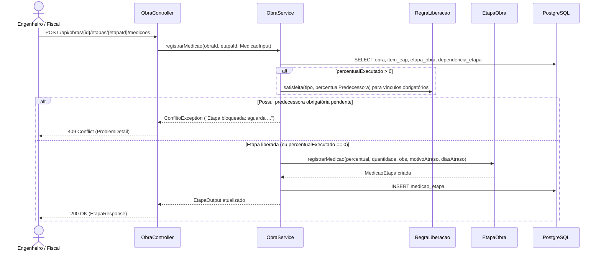

# Implementação Técnica — UC-OBR-003 (Registrar Medição e Apontar Atraso em Etapa)

## 1. Pontos de Entrada e Participantes

| Camada / Papel | Caminho do Arquivo | Símbolo Principal | Responsabilidade no Fluxo |
| --- | --- | --- | --- |
| Entrada REST (Controller) | `api/src/main/java/br/com/concordia/infrastructure/obra/ObraController.java` | `ObraController.registrarMedicao()` | Recebe `POST /api/obras/{id}/etapas/{etapaId}/medicoes`, valida `@Valid MedicaoRequest` e delega ao serviço |
| DTO de Entrada | `api/src/main/java/br/com/concordia/infrastructure/obra/dtos/MedicaoRequest.java` | `MedicaoRequest` | Valida limites de `percentualExecutado` (`0`..`100`), `quantidadeExecutada` (`>= 0`), tamanhos de `observacao` (1000) e `motivoAtraso` (500) e `diasAtraso` (`>= 0`) |
| Aplicação / Orquestração | `api/src/main/java/br/com/concordia/domain/obra/ObraService.java` | `ObraService.registrarMedicao()`, `ObraService.ContextoEtapas.predecessorasPendentes()` | Verifica bloqueio por predecessoras (`RN-OBR-002`), comanda o registro na entidade e persiste o agregado `Obra` |
| Domínio | `api/src/main/java/br/com/concordia/domain/obra/entities/EtapaObra.java`, `api/src/main/java/br/com/concordia/domain/obra/entities/MedicaoEtapa.java`, `api/src/main/java/br/com/concordia/domain/obra/dependencia/RegraLiberacao.java` | `EtapaObra.registrarMedicao()`, `EtapaObra.percentualAtual()`, `MedicaoEtapa`, `RegraLiberacao.satisfeita()` | Cria instância de `MedicaoEtapa` com `OffsetDateTime.now()`, adiciona à coleção ordenada `medicoes` e expõe o percentual corrente |
| Componente UI (Design System) | `web/src/components/organisms/StageDetailsDrawer/StageDetailsDrawer.tsx` | `StageDetailsDrawer` | Gaveta lateral para ajuste de percentual via slider/botões rápidos e reporte de impedimento com callbacks `onSaveMeasurement` e `onReportImpediment` |
| Cliente HTTP Gerado | `web/src/api/generated/obras/obras.ts` | `registrarMedicao()`, `useRegistrarMedicao()` | Funções e hooks gerados pelo Orval para `POST /api/obras/{id}/etapas/{etapaId}/medicoes` |

## 2. Percurso Técnico, Transações e Eventos

1. **Entrada e Contrato:**
   - `POST /api/obras/{id}/etapas/{etapaId}/medicoes` recebe um JSON correspondente a `MedicaoRequest`.
   - Bean Validation garante `@NotNull`, `@DecimalMin("0")`, `@DecimalMax("100")` para `percentualExecutado` e `@NotNull`, `@DecimalMin("0")` para `quantidadeExecutada`.
2. **Controle Transacional e Persistência:**
   - `ObraService.registrarMedicao()` executa dentro de `@Transactional`.
   - Carrega a `Obra` e localiza a `EtapaObra` em `obra.getEtapas()`.
   - Se `request.percentualExecutado().signum() > 0`, calcula `contexto(obra).predecessorasPendentes(etapaId)`. Havendo qualquer predecessora obrigatória não satisfeita, lança `ConflitoException` antes de tocar na entidade.
   - Chama `etapa.registrarMedicao(...)`, que instancia `MedicaoEtapa` (visibilidade package-private) e a insere em `EtapaObra.medicoes`.
   - Invoca `obraRepository.save(obra)` (persistindo a nova `MedicaoEtapa` em `medicao_etapa` por `CascadeType.ALL`) e retorna `consultarEtapa(obraId, etapaId)`.
3. **Eventos e Processamento Assíncrono:**
   - Não há mensageria. O desbloqueio de etapas sucessoras não exige atualização física nas linhas das sucessoras porque o campo `bloqueada` e a satisfação de cada vínculo são calculados sob demanda a partir de `predecessora.percentualAtual()` em `RegraLiberacao.satisfeita()`.
4. **Tratamento de Falhas e Retentativas:**
   - `ConflitoException` é convertida por `GlobalExceptionHandler.handleConflito()` em `ProblemDetail` HTTP `409 Conflict`.
   - `EntityNotFoundException` é convertida em HTTP `404 Not Found`.

## 3. Guardrails e Restrições Técnicas (O que NÃO fazer)

- **Construtor Protegido de `MedicaoEtapa`:** Nunca instancie `MedicaoEtapa` diretamente fora do pacote de entidades; utilize exclusivamente `EtapaObra.registrarMedicao(...)` para garantir o vínculo bidirecional e o preenchimento de `registradaEm`.
- **Ordem do Histórico de Medições:** `EtapaObra.medicoes` utiliza `@OrderBy("registradaEm ASC")` e `EtapaObra.percentualAtual()` lê sempre o último elemento (`medicoes.get(medicoes.size() - 1)`). Nunca reordene a lista em memória em ordem decrescente nem remova medições antigas ao registrar uma nova.
- **Verificação de Bloqueio Obrigatória:** Nunca permita persistir `percentualExecutado > 0` sem antes validar `contexto(obra).predecessorasPendentes(etapaId)` (`RN-OBR-002`).

## 4. Diagramas

## 5. Rastreabilidade de Testes Automatizados

| Cenário / Regra | Tipo de Teste | Arquivo de Teste | Nome do Teste / Método |
| --- | --- | --- | --- |
| `UC-OBR-003-C01`, `RN-OBR-002` | Unitário (Backend) | `api/src/test/java/br/com/concordia/domain/obra/dependencia/DependenciaEtapaServiceTest.java` | `bloqueiaSucessoraAteAPredecessoraConcluir`, `inicioInicioLiberaQuandoAPredecessoraComeca` |
| `UC-OBR-003-C03`, `RN-OBR-002` | Unitário (Backend) | `api/src/test/java/br/com/concordia/domain/obra/dependencia/DependenciaEtapaServiceTest.java` | `recusaMedicaoDeEtapaBloqueada` |
| `UC-OBR-003-C01`, `UC-OBR-003-C02` | Componente (Frontend) | `web/src/tests/StageDetailsDrawer.component.test.tsx`, `web/src/tests/m2_drawer_stress.test.tsx`, `web/src/tests/m2_empirical_challenge.test.tsx` | `changing slider range updates progress and live executed quantity`, `clicking "Salvar Medição" invokes callbacks with calculated quantity and displays success message`, `expands impediment form, validates input, and submits with onReportImpediment callback` |

Não há teste automatizado de integração HTTP (MockMvc) cobrindo `UC-OBR-003-C04` (validação Bean Validation de `MedicaoRequest`) e `UC-OBR-003-C05` (etapa inexistente).
