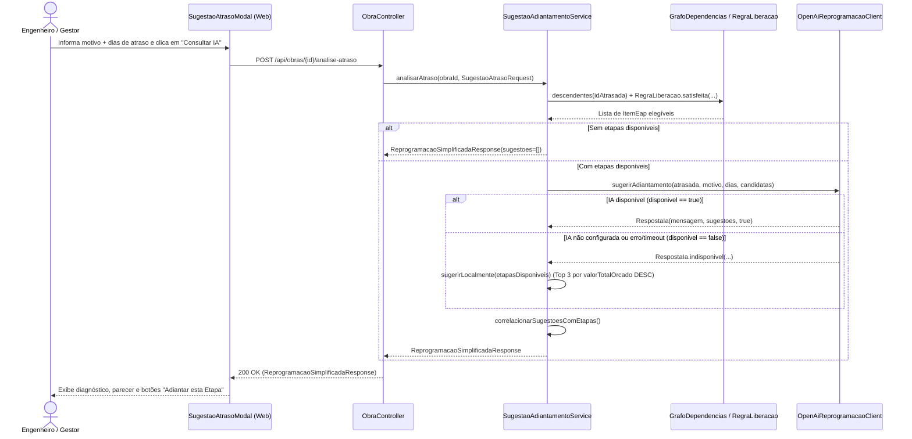

# Implementação Técnica — UC-OBR-004 (Analisar Atraso e Gerar Sugestões de Adiantamento)

## 1. Pontos de Entrada e Participantes

| Camada / Papel | Caminho do Arquivo | Símbolo Principal | Responsabilidade no Fluxo |
| --- | --- | --- | --- |
| Entrada UI (Página e Modal) | `web/src/pages/TimelinePage.tsx`, `web/src/components/molecules/SugestaoAtrasoModal/SugestaoAtrasoModal.tsx` | `TimelinePage.handleAnalisarAtraso()`, `SugestaoAtrasoModal` | Abre o modal de atraso, coleta `motivo` e `diasAtraso`, aciona a mutação e renderiza o parecer técnico e os botões `"Adiantar esta Etapa"` |
| Cliente HTTP Gerado | `web/src/api/generated/obras/obras.ts` | `analisarAtraso()`, `useAnalisarAtraso()` | Envia `POST /api/obras/{id}/analise-atraso` |
| Entrada REST (Controller) | `api/src/main/java/br/com/concordia/infrastructure/obra/ObraController.java` | `ObraController.analisarAtraso()` | Recebe `POST /api/obras/{id}/analise-atraso` com `@Valid SugestaoAtrasoRequest` |
| DTOs REST | `api/src/main/java/br/com/concordia/infrastructure/obra/dtos/SugestaoAtrasoRequest.java`, `api/src/main/java/br/com/concordia/infrastructure/obra/dtos/ReprogramacaoSimplificadaResponse.java`, `api/src/main/java/br/com/concordia/infrastructure/obra/dtos/SugestaoEtapaResponse.java` | `SugestaoAtrasoRequest`, `ReprogramacaoSimplificadaResponse`, `SugestaoEtapaResponse` | Contratos de entrada (`etapaId`, `motivo`, `diasAtraso`) e saída (`mensagem`, `sugestoes`) |
| Aplicação / Domínio | `api/src/main/java/br/com/concordia/domain/obra/SugestaoAdiantamentoService.java`, `api/src/main/java/br/com/concordia/domain/obra/dependencia/GrafoDependencias.java`, `api/src/main/java/br/com/concordia/domain/obra/dependencia/RegraLiberacao.java` | `SugestaoAdiantamentoService.analisarAtraso()`, `filtrarEtapasDisponiveisParaAdiantamento()`, `sugerirLocalmente()`, `GrafoDependencias.descendentes()`, `RegraLiberacao.satisfeita()` | Filtra candidatas elegíveis (`RN-OBR-003`), aciona a porta `IaReprogramacaoClient`, executa fallback local se necessário e valida IDs retornados |
| Porta e Adaptador de IA | `api/src/main/java/br/com/concordia/domain/obra/ports/IaReprogramacaoClient.java`, `api/src/main/java/br/com/concordia/infrastructure/ia/client/OpenAiReprogramacaoClient.java`, `api/src/main/java/br/com/concordia/infrastructure/ia/config/ConcordiaIaProperties.java` | `IaReprogramacaoClient.sugerirAdiantamento()`, `OpenAiReprogramacaoClient.sugerirAdiantamento()`, `ConcordiaIaProperties` | Monta prompts de engenharia civil, consome `POST /chat/completions` via `RestClient`, sanitiza blocos Markdown JSON e trata indisponibilidades |

## 2. Percurso Técnico, Transações e Eventos

1. **Entrada e Contrato:**
   - `POST /api/obras/{id}/analise-atraso` recebe `SugestaoAtrasoRequest` (`etapaId` `@NotNull`, `motivo` `@NotBlank`, `diasAtraso` `@Min(1)`).
2. **Controle Transacional e Persistência:**
   - `SugestaoAdiantamentoService` é anotado com `@Transactional(readOnly = true)`. Nenhuma escrita no banco é realizada.
   - Carrega a `Obra` via `obraRepository.findById(obraId)` e as dependências via `dependenciaRepository.findByObraId(obraId)`.
   - Constrói `GrafoDependencias` e exclui qualquer etapa que já tenha medição (`percentualAtual > 0`), que pertença a `grafo.descendentes(idAtrasada)` ou que possua vínculo obrigatório não satisfeito em `RegraLiberacao.satisfeita()`.
3. **Integração Externa e Fallback Local:**
   - `OpenAiReprogramacaoClient` verifica `properties.isConfigured()`. Caso `apiKey` esteja vazia ou ocorra exceção HTTP/JSON, retorna `RespostaIa.indisponivel(...)` (`disponivel = false`).
   - Em `SugestaoAdiantamentoService.analisarAtraso()`, somente quando `respostaIa == null || !respostaIa.disponivel()` o método `sugerirLocalmente(etapasDisponiveis)` é executado.
   - Por fim, `correlacionarSugestoesComEtapas()` descarta qualquer `etapaId` retornado pela IA que não pertença ao mapa de `etapasDisponiveis`.

## 3. Guardrails e Restrições Técnicas (O que NÃO fazer)

- **Nunca Pular a Pós-Validação das Sugestões da IA:** Mesmo que apenas candidatas elegíveis sejam enviadas no prompt, `correlacionarSugestoesComEtapas()` deve sempre validar cada `sugestao.etapaId()` contra `mapaEtapasPorId` (`etapasDisponiveis`) para impedir que UUIDs alucinados pelo modelo cheguem ao usuário.
- **Nunca Acionar Fallback Local Quando `disponivel == true`:** Quando o provedor de IA está configurado e responde um JSON válido com `"sugestoes": []` (`disponivel = true`), o serviço deve respeitar o parecer técnico da IA e retornar lista vazia sem sobrescrevê-la com `sugerirLocalmente()`.
- **Sanitização de Cercas Markdown no Adaptador IA:** `OpenAiReprogramacaoClient.sanitizarJson()` deve remover prefixos ` ```json ` e sufixos ` ``` ` antes de invocar `jsonMapper.readValue()`, pois modelos compatíveis com OpenAI frequentemente cercam o JSON com blocos de código Markdown.

## 4. Diagramas



## 5. Rastreabilidade de Testes Automatizados

| Cenário / Regra | Tipo de Teste | Arquivo de Teste | Nome do Teste / Método |
| --- | --- | --- | --- |
| `UC-OBR-004-C01`, `RN-OBR-003` | Unitário (Backend) | `api/src/test/java/br/com/concordia/domain/obra/SugestaoAdiantamentoServiceTest.java` | `deveRetornarSugestoesEnriquecidasQuandoIaRetornaRecomendacoes` |
| `UC-OBR-004-C02`, `RN-OBR-002`, `RN-OBR-003` | Unitário (Backend) | `api/src/test/java/br/com/concordia/domain/obra/SugestaoAdiantamentoServiceTest.java` | `deveSelecionarNoMaximoTresCandidatasPorOrcamentoQuandoIaIndisponivel`, `deveExcluirDependentesDiretasIndiretasEBloqueadasDaSelecaoLocal` |
| `UC-OBR-004-C02` | Unitário (Backend) | `api/src/test/java/br/com/concordia/infrastructure/ia/client/OpenAiReprogramacaoClientTest.java` | `deveRetornarMensagemExplicativaQuandoNaoConfigurado` |
| `UC-OBR-004-C03`, `RN-OBR-003` | Unitário (Backend) | `api/src/test/java/br/com/concordia/domain/obra/SugestaoAdiantamentoServiceTest.java` | `deveRetornarMensagemExplicativaQuandoIaNaoIdentificaEtapas` |
| `UC-OBR-004-C04` | Unitário (Backend) | `api/src/test/java/br/com/concordia/infrastructure/ia/client/OpenAiReprogramacaoClientTest.java` | `deveRetornarMensagemExplicativaQuandoNaoHaEtapasCandidatas` |
| `UC-OBR-004-C01`, `UC-OBR-004-C03`, `UC-OBR-004-C04` | Componente (Frontend) | `web/src/tests/SugestaoAtrasoModal.component.test.tsx` | `runTests` (submissão do formulário, lista de sugestões, seleção de etapa, parecer sem sugestões e estado de erro) |
| `UC-OBR-004-C01`, `UC-OBR-004-C03` | E2E (Playwright) | `web/tests/e2e/timeline.spec.ts` | `exibe a trilha de etapas da obra e permite indicar atraso com IA`, `exibe parecer descritivo da IA quando não houver etapas para adiantar` |
