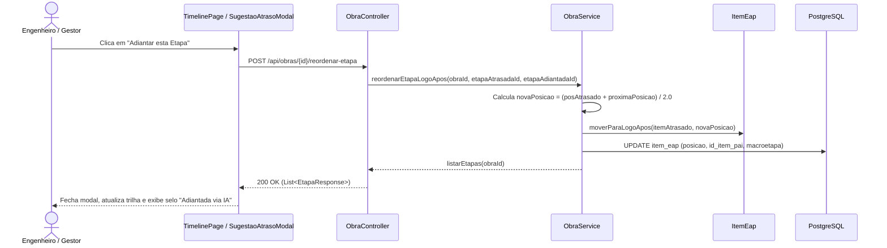

# Implementação Técnica — UC-OBR-005 (Reordenar Etapa Adiantada na Trilha da Obra)

## 1. Pontos de Entrada e Participantes

| Camada / Papel | Caminho do Arquivo | Símbolo Principal | Responsabilidade no Fluxo |
| --- | --- | --- | --- |
| Entrada UI (Página e Modal) | `web/src/pages/TimelinePage.tsx`, `web/src/components/molecules/SugestaoAtrasoModal/SugestaoAtrasoModal.tsx` | `TimelinePage.handleEscolherEtapa()`, `SugestaoAtrasoModal` | Dispara a mutação de reordenação, registra o vínculo de adiantamento no estado da página, fecha o modal e recarrega a query de etapas |
| Cliente HTTP Gerado | `web/src/api/generated/obras/obras.ts` | `reordenarEtapa()`, `useReordenarEtapa()` | Envia `POST /api/obras/{id}/reordenar-etapa` |
| Entrada REST (Controller) | `api/src/main/java/br/com/concordia/infrastructure/obra/ObraController.java` | `ObraController.reordenarEtapa()` | Recebe `POST /api/obras/{id}/reordenar-etapa` com `@Valid ReordenarEtapaRequest` e retorna `List<EtapaResponse>` |
| DTO REST | `api/src/main/java/br/com/concordia/infrastructure/obra/dtos/ReordenarEtapaRequest.java` | `ReordenarEtapaRequest` | Record com `@NotNull UUID etapaAtrasadaId` e `@NotNull UUID etapaAdiantadaId` |
| Aplicação / Domínio | `api/src/main/java/br/com/concordia/domain/obra/ObraService.java`, `api/src/main/java/br/com/concordia/domain/obra/entities/ItemEap.java` | `ObraService.reordenarEtapaLogoApos()`, `ItemEap.moverParaLogoApos()` | Calcula a nova posição fracionária `(posAtrasado + proximaPosicao) / 2.0`, realinha `pai` e `macroetapa` em `ItemEap` e salva a obra |

## 2. Percurso Técnico, Transações e Eventos

1. **Entrada e Contrato:**
   - `POST /api/obras/{id}/reordenar-etapa` recebe `ReordenarEtapaRequest` (`etapaAtrasadaId`, `etapaAdiantadaId`) e retorna `200 OK` com `List<EtapaResponse>` já ordenada pela nova posição.
2. **Controle Transacional e Persistência:**
   - `ObraService.reordenarEtapaLogoApos()` executa sob `@Transactional`.
   - Filtra `obra.getEap()` mantendo os itens que possuem `EtapaObra`, ordenados por `ItemEap::getPosicao`.
   - Localiza `itemAtrasado` e `itemAdiantado` aceitando tanto o UUID de `EtapaObra` quanto o UUID de `ItemEap`.
   - Calcula `novaPosicao = (posAtrasado + proximaPosicao) / 2.0` e invoca `itemAdiantado.moverParaLogoApos(itemAtrasado, novaPosicao)`, que atualiza `posicao`, `pai` e `macroetapa` do item adiantado.
   - Persiste via `obraRepository.save(obra)` e retorna `listarEtapas(obraId)`.

## 3. Guardrails e Restrições Técnicas (O que NÃO fazer)

- **Atualização Conjunta de Posição e Macroetapa:** Nunca altere apenas `ItemEap.posicao` sem chamar `ItemEap.moverParaLogoApos(itemAtrasado, novaPosicao)`. Como a `TimelinePage` agrupa as etapas por macroetapa e subetapa, manter a `macroetapa` antiga impediria que uma etapa adiantada de outro grupo aparecesse visualmente ao lado da etapa atrasada.

## 4. Diagramas

## 5. Rastreabilidade de Testes Automatizados

| Cenário / Regra | Tipo de Teste | Arquivo de Teste | Nome do Teste / Método |
| --- | --- | --- | --- |
| `UC-OBR-005-C01`, `RN-OBR-005` | Unitário (Backend) | `api/src/test/java/br/com/concordia/domain/obra/ObraServiceReordenacaoTest.java` | `deveReordenarEtapaParaFicarLogoAposEtapaAtrasada` |
| `UC-OBR-005-C01`, `RN-OBR-005` | Componente (Frontend) | `web/src/tests/SugestaoAtrasoModal.component.test.tsx` | `ao clicar em "Adiantar esta Etapa" em uma sugestão aciona o callback onEscolherEtapa` |
| `UC-OBR-005-C01`, `RN-OBR-005` | E2E (Playwright) | `web/tests/e2e/timeline.spec.ts` | `ao escolher etapa sugerida pela IA posiciona logo apos a etapa atrasada` |
