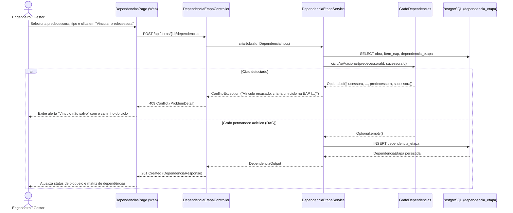

# Implementação Técnica — UC-OBR-006 (Configurar Dependências Construtivas entre Etapas)

## 1. Pontos de Entrada e Participantes

| Camada / Papel | Caminho do Arquivo | Símbolo Principal | Responsabilidade no Fluxo |
| --- | --- | --- | --- |
| Entrada UI (Página) | `web/src/pages/DependenciasPage.tsx` | `DependenciasPage` | Orquestra a seleção de etapas, edição de vínculos e matriz de dependências na rota `/obras/:obraId/dependencias` |
| Organismos e Moléculas UI | `web/src/components/organisms/EtapaNavigator/EtapaNavigator.tsx`, `web/src/components/organisms/DependencyEditor/DependencyEditor.tsx`, `web/src/components/organisms/DependencyTable/DependencyTable.tsx`, `web/src/components/molecules/EtapaPicker/EtapaPicker.tsx`, `web/src/components/molecules/DependencyLinkItem/DependencyLinkItem.tsx` | `EtapaNavigator`, `DependencyEditor`, `DependencyTable`, `EtapaPicker`, `DependencyLinkItem` | Navegação lateral de etapas com filtro, formulário de adição de predecessora, edição/remoção de vínculos e matriz global |
| Cliente HTTP Gerado | `web/src/api/generated/dependências/dependências.ts`, `web/src/services/apiProblem.ts` | `listarDependencias()`, `criarDependencia()`, `atualizarDependencia()`, `removerDependencia()`, `ensureOk()` | Comunicação REST com `/api/obras/{id}/dependencias` e conversão de erros HTTP 4xx/409 em `ApiProblemError` |
| Entrada REST (Controller) | `api/src/main/java/br/com/concordia/infrastructure/obra/DependenciaEtapaController.java` | `DependenciaEtapaController.listarDependencias()`, `criarDependencia()`, `atualizarDependencia()`, `removerDependencia()` | Endpoints REST em `/api/obras/{id}/dependencias` |
| DTOs REST | `api/src/main/java/br/com/concordia/infrastructure/obra/dtos/DependenciaRequest.java`, `api/src/main/java/br/com/concordia/infrastructure/obra/dtos/DependenciaParcialRequest.java`, `api/src/main/java/br/com/concordia/infrastructure/obra/dtos/DependenciaResponse.java` | `DependenciaRequest`, `DependenciaParcialRequest`, `DependenciaResponse` | Contratos de requisição e resposta com validações `@NotNull`, `@Min(-365)` e `@Max(365)` |
| Aplicação / Domínio | `api/src/main/java/br/com/concordia/domain/obra/dependencia/DependenciaEtapaService.java`, `api/src/main/java/br/com/concordia/domain/obra/dependencia/GrafoDependencias.java`, `api/src/main/java/br/com/concordia/domain/obra/dependencia/RegraLiberacao.java` | `DependenciaEtapaService.listar()`, `criar()`, `atualizar()`, `remover()`, `GrafoDependencias.cicloAoAdicionar()`, `RegraLiberacao.satisfeita()` | Valida pertencimento à obra, unicidade, ausência de autodependência e aciclicidade via BFS antes de persistir |
| Entidade e Persistência | `api/src/main/java/br/com/concordia/domain/obra/entities/DependenciaEtapa.java`, `api/src/main/java/br/com/concordia/infrastructure/obra/repositories/DependenciaEtapaRepositoryImpl.java`, `api/src/main/resources/db/migration/V3__dependencias_etapa.sql` | `DependenciaEtapa`, `DependenciaEtapaRepositoryImpl` | Persistência JPA na tabela `dependencia_etapa` com constraints `ck_dependencia_etapa_distintas` e `uk_dependencia_etapa_par` |

## 2. Percurso Técnico, Transações e Eventos

1. **Entrada e Contrato:**
   - `GET /api/obras/{id}/dependencias` → `200 OK` (`List<DependenciaResponse>`)
   - `POST /api/obras/{id}/dependencias` → `201 Created` (`DependenciaResponse`)
   - `PATCH /api/obras/{id}/dependencias/{dependenciaId}` → `200 OK` (`DependenciaResponse`)
   - `DELETE /api/obras/{id}/dependencias/{dependenciaId}` → `204 No Content`
2. **Controle Transacional e Persistência:**
   - `DependenciaEtapaService.criar()` executa sob `@Transactional`. Carrega o mapa de etapas da obra (`etapasPorId(obra)`), verifica autodependência e duplicidade em memória, instancia `GrafoDependencias` com as arestas existentes e executa `grafo.cicloAoAdicionar(predecessoraId, sucessoraId)`.
   - Se `cicloAoAdicionar` retornar um caminho, lança `ConflitoException` (HTTP `409`) formatando cada UUID com `rotulo(etapas.get(id))` (`codigoEap` ou `nome`) unido por `" → "`.
   - Caso contrário, persiste `DependenciaEtapa` via `repository.save(dependencia)`. No banco, `V3__dependencias_etapa.sql` garante em nível relacional `id_etapa_predecessora <> id_etapa_sucessora` e unicidade de `(id_obra, id_etapa_predecessora, id_etapa_sucessora)`.
3. **Eventos e Processamento Assíncrono:**
   - Na UI (`DependenciasPage.tsx`), após criar, atualizar ou remover uma dependência, o callback `invalidate()` invalida simultaneamente as queries `getListarDependenciasQueryKey(obraId)` e `getListarEtapasQueryKey(obraId)` para sincronizar o status `bloqueada` das etapas.

## 3. Guardrails e Restrições Técnicas (O que NÃO fazer)

- **Detecção de Ciclo Antes do `save`:** Nunca remova a chamada a `GrafoDependencias.cicloAoAdicionar()` em `DependenciaEtapaService.criar()`. O banco relacional impede apenas autodependência direta (`A -> A`) e duplicidade de par, mas não detecta ciclos de 2 ou mais saltos (`A -> B -> A` ou `A -> B -> C -> A`).
- **Verificação de Pertencimento à Obra no `PATCH` e `DELETE`:** Em `DependenciaEtapaService.obterDependencia(obraId, dependenciaId)`, mantenha sempre o filtro `.filter(d -> d.getObra().getId().equals(obraId))` para impedir alteração ou exclusão de dependências pertencentes a outra obra.

## 4. Diagramas

## 5. Rastreabilidade de Testes Automatizados

| Cenário / Regra | Tipo de Teste | Arquivo de Teste | Nome do Teste / Método |
| --- | --- | --- | --- |
| `UC-OBR-006-C01`, `RN-OBR-002`, `RN-OBR-004` | Unitário (Backend) | `api/src/test/java/br/com/concordia/domain/obra/dependencia/DependenciaEtapaServiceTest.java` | `criaVinculoComPadroesFimInicioObrigatorio`, `bloqueiaSucessoraAteAPredecessoraConcluir`, `inicioInicioLiberaQuandoAPredecessoraComeca` |
| `UC-OBR-006-C02`, `RN-OBR-002` | Unitário (Backend) | `api/src/test/java/br/com/concordia/domain/obra/dependencia/DependenciaEtapaServiceTest.java` | `atualizaERemoveVinculo`, `vinculoNaoObrigatorioNaoBloqueia` |
| `UC-OBR-006-C03`, `RN-OBR-004` | Unitário (Backend) | `api/src/test/java/br/com/concordia/domain/obra/dependencia/GrafoDependenciasTest.java`, `api/src/test/java/br/com/concordia/domain/obra/dependencia/DependenciaEtapaServiceTest.java` | `detectaCicloIndiretoEDevolveOCaminho`, `detectaCicloDireto`, `aceitaVinculosParalelosSemCiclo`, `recusaCicloInformandoOCaminho` |
| `UC-OBR-006-C04`, `UC-OBR-006-C05`, `UC-OBR-006-C06`, `RN-OBR-004` | Unitário (Backend) | `api/src/test/java/br/com/concordia/domain/obra/dependencia/DependenciaEtapaServiceTest.java` | `recusaVinculoDuplicadoEAutoDependencia`, `recusaDesfasamentoForaDoLimite`, `recusaEtapaDeOutraObra` |
| `UC-OBR-006-C01`, `UC-OBR-006-C02` | Componente (Frontend) | `web/src/tests/Dependencias.component.test.tsx` | `runTests` (`EtapaNavigator`, `EtapaPicker`, `DependencyLinkItem`, `DependencyEditor`, `DependencyTable`) |
| `UC-OBR-006-C01`, `UC-OBR-006-C03` | E2E / Acessibilidade (Playwright) | `web/tests/e2e/dependencias.spec.ts` | `UC06: lista etapas, vínculos e etapas bloqueadas`, `UC06 (passo 3): recusa vínculo que criaria ciclo e exibe o caminho`, `UC06 (passo 4): salva vínculo e atualiza a regra de liberação`, `UC06: trilha mostra o cadeado e a predecessora pendente`, `UC06: tela de dependências sem violações críticas de acessibilidade` |
