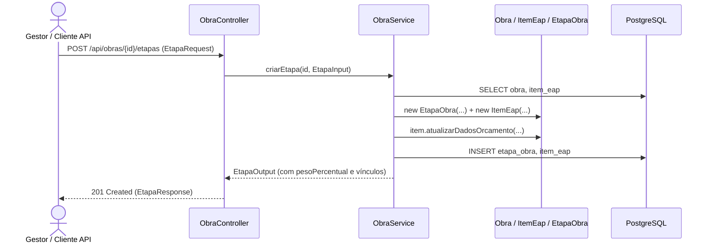

# Implementação Técnica — UC-OBR-007 (Gerenciar Cadastro de Obras e Etapas da EAP)

## 1. Pontos de Entrada e Participantes

| Camada / Papel | Caminho do Arquivo | Símbolo Principal | Responsabilidade no Fluxo |
| --- | --- | --- | --- |
| Entrada REST (Controller) | `api/src/main/java/br/com/concordia/infrastructure/obra/ObraController.java` | `ObraController.criar()`, `consultar()`, `atualizar()`, `atualizarParcial()`, `deletar()`, `listar()`, `criarEtapa()`, `consultarEtapa()`, `atualizarDadosOrcamento()` | Expõe os endpoints REST de gestão cadastral de obras e etapas em `/api/obras` |
| DTOs e Mappers de Infraestrutura | `api/src/main/java/br/com/concordia/infrastructure/obra/dtos/ObraRequest.java`, `api/src/main/java/br/com/concordia/infrastructure/obra/dtos/ObraParcialRequest.java`, `api/src/main/java/br/com/concordia/infrastructure/obra/dtos/ObraResponse.java`, `api/src/main/java/br/com/concordia/infrastructure/obra/dtos/EtapaRequest.java`, `api/src/main/java/br/com/concordia/infrastructure/obra/dtos/EtapaResponse.java`, `api/src/main/java/br/com/concordia/infrastructure/obra/ObraInfraMapper.java` | `ObraRequest`, `ObraParcialRequest`, `ObraResponse`, `EtapaRequest`, `EtapaResponse`, `ObraInfraMapper` | Validação de entrada e conversão entre contratos HTTP e DTOs de domínio |
| Aplicação / Domínio | `api/src/main/java/br/com/concordia/domain/obra/ObraService.java`, `api/src/main/java/br/com/concordia/domain/obra/ObraMapper.java` | `ObraService.criar()`, `consultar()`, `atualizar()`, `atualizarParcial()`, `deletar()`, `listar()`, `criarEtapa()`, `consultarEtapa()`, `atualizarOrcamentoEtapa()` | Coordenação transacional de obras e etapas e cálculo de contexto/pesos |
| Entidades e Repositórios | `api/src/main/java/br/com/concordia/domain/obra/entities/Obra.java`, `api/src/main/java/br/com/concordia/domain/obra/entities/EtapaObra.java`, `api/src/main/java/br/com/concordia/domain/obra/entities/ItemEap.java`, `api/src/main/java/br/com/concordia/infrastructure/obra/repositories/ObraRepositoryImpl.java` | `Obra`, `EtapaObra`, `ItemEap`, `ObraRepositoryImpl` | Entidades JPA e adaptador de persistência em `obra`, `etapa_obra` e `item_eap` |
| Cliente HTTP Gerado | `web/src/api/generated/obras/obras.ts` | `criar()`, `consultar()`, `atualizar()`, `atualizarParcial()`, `deletar()`, `listar()`, `criarEtapa()`, `consultarEtapa()`, `atualizarDadosOrcamento()` | Funções e hooks TanStack Query gerados pelo Orval |

## 2. Percurso Técnico, Transações e Eventos

1. **Entrada e Contrato:**
   - `POST /api/obras` → `201 Created` (`ObraResponse`)
   - `GET /api/obras` → `200 OK` (`List<ObraResponse>`)
   - `GET /api/obras/{id}` → `200 OK` (`ObraResponse`)
   - `PUT /api/obras/{id}` → `200 OK` (`ObraResponse`)
   - `PATCH /api/obras/{id}` → `200 OK` (`ObraResponse`)
   - `DELETE /api/obras/{id}` → `204 No Content`
   - `POST /api/obras/{id}/etapas` → `201 Created` (`EtapaResponse`)
   - `GET /api/obras/{id}/etapas/{etapaId}` → `200 OK` (`EtapaResponse`)
   - `PATCH /api/obras/{id}/etapas/{etapaId}/orcamento` → `200 OK` (`EtapaResponse`)
2. **Controle Transacional e Persistência:**
   - Em `ObraService.criarEtapa()`, o serviço carrega a `Obra`, resolve opcionalmente o `ItemEap` pai dentro de `obra.getEap()`, instancia `EtapaObra` e `ItemEap`, preenche os dados orçamentários via `item.atualizarDadosOrcamento(...)`, adiciona ambos ao agregado `Obra` e persiste com `obraRepository.save(obra)`.

## 3. Guardrails e Restrições Técnicas (O que NÃO fazer)

- **Consistência entre `EtapaObra` e `ItemEap`:** Toda `EtapaObra` criada precisa estar vinculada a um `ItemEap` na coleção `obra.getEap()`, pois `ObraService.listarEtapas()`, `consultarEtapa()` e `atualizarOrcamentoEtapa()` percorrem `obra.getEap()` filtrando `item.getEtapa() != null`.

## 4. Diagramas

## 5. Rastreabilidade de Testes Automatizados

| Cenário / Regra | Tipo de Teste | Arquivo de Teste | Nome do Teste / Método |
| --- | --- | --- | --- |
| `UC-OBR-007-C01`, `RN-OBR-001` | Unitário (Backend) | `api/src/test/java/br/com/concordia/domain/obra/dependencia/DependenciaEtapaServiceTest.java` | `calculaPesoPercentualDaEtapa` |

Não há suíte de testes unitários ou de integração dedicada exclusivamente às operações de `PUT`, `PATCH` e `DELETE` de `Obra` ou `criarEtapa`/`atualizarOrcamentoEtapa`.
