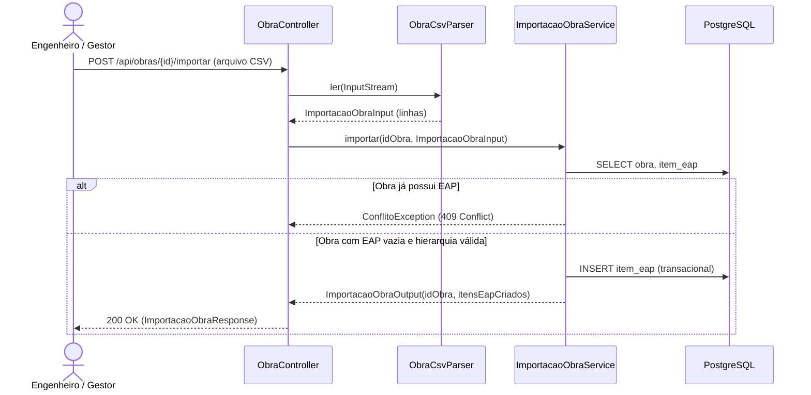

# Implementação Técnica — UC-OBR-008 (Importar Estrutura da EAP via Arquivo CSV)

## 1. Pontos de Entrada e Participantes

| Camada / Papel | Caminho do Arquivo | Símbolo Principal | Responsabilidade no Fluxo |
| --- | --- | --- | --- |
| Entrada REST (Controller) | `api/src/main/java/br/com/concordia/infrastructure/obra/ObraController.java` | `ObraController.importar()` | Recebe `POST /api/obras/{id}/importar` (`multipart/form-data`, parâmetro `arquivo`), valida se não está vazio, aciona `ObraCsvParser` e delega a `ImportacaoObraService` |
| Parser CSV | `api/src/main/java/br/com/concordia/infrastructure/obra/csv/ObraCsvParser.java` | `ObraCsvParser.ler()` | Lê o stream UTF-8, remove BOM, valida o cabeçalho de 5 colunas e converte as linhas em `ImportacaoObraInput` |
| Aplicação / Domínio | `api/src/main/java/br/com/concordia/domain/obra/ImportacaoObraService.java`, `api/src/main/java/br/com/concordia/domain/obra/dtos/ImportacaoObraInput.java`, `api/src/main/java/br/com/concordia/domain/obra/dtos/LinhaImportacao.java`, `api/src/main/java/br/com/concordia/domain/obra/dtos/ImportacaoObraOutput.java` | `ImportacaoObraService.importar()`, `criarItemEap()`, `LinhaImportacao` | Valida EAP vazia, unicidade e precedência Pai → Filho, adiciona `ItemEap` à obra e salva via `ObraRepository` |
| DTO de Resposta | `api/src/main/java/br/com/concordia/infrastructure/obra/dtos/ImportacaoObraResponse.java` | `ImportacaoObraResponse` | Retorna `idObra` e `itensEapCriados` |
| Planilha de Exemplo | `docs/exemplo_importacao_obra.csv` | Arquivo CSV de referência | Exemplo de planilha CSV compatível com o cabeçalho e hierarquia esperados |

## 2. Percurso Técnico, Transações e Eventos

1. **Entrada e Contrato:**
   - `POST /api/obras/{id}/importar` (`multipart/form-data`, campo `arquivo`) retorna `200 OK` com `ImportacaoObraResponse` (`idObra`, `itensEapCriados`).
2. **Controle Transacional e Persistência:**
   - `ObraCsvParser.ler()` é executado no controller antes da abertura da transação de domínio.
   - `ImportacaoObraService.importar()` executa sob `@Transactional`. Verifica `obra.getEap().isEmpty()`, instancia os nós `ItemEap` com posições `posicao * 1000.0` e executa `obraRepository.save(obra)`.

## 3. Guardrails e Restrições Técnicas (O que NÃO fazer)

- **Não Sobrescrever EAP Existente:** Nunca remova a checagem `if (!obra.getEap().isEmpty()) throw new ConflitoException(...)` em `ImportacaoObraService.importar()`, evitando duplicação de nós na árvore da obra.

## 4. Diagramas

## 5. Rastreabilidade de Testes Automatizados

| Cenário / Regra | Tipo de Teste | Arquivo de Teste | Nome do Teste / Método |
| --- | --- | --- | --- |
| `UC-OBR-008-C01`, `RN-OBR-008-01` | Unitário (Backend) | `api/src/test/java/br/com/concordia/infrastructure/obra/csv/ObraCsvParserTest.java`, `api/src/test/java/br/com/concordia/domain/obra/ImportacaoObraServiceTest.java` | `leAgrupamentosEItensComAspasEDecimalBrasileiro`, `montaArvoreDaEapPelaNumeracao` |
| `UC-OBR-008-C02`, `RN-OBR-008-01` | Unitário (Backend) | `api/src/test/java/br/com/concordia/domain/obra/ImportacaoObraServiceTest.java` | `rejeitaObraQueJaPossuiEap` |
| `UC-OBR-008-C03`, `RN-OBR-008-01` | Unitário (Backend) | `api/src/test/java/br/com/concordia/infrastructure/obra/csv/ObraCsvParserTest.java`, `api/src/test/java/br/com/concordia/domain/obra/ImportacaoObraServiceTest.java` | `rejeitaCabecalhoInvalido`, `rejeitaArquivoVazio`, `rejeitaQuantidadeInvalida`, `rejeitaItemComCodigoSemQuantidade`, `rejeitaNumeroErradoDeColunas`, `rejeitaItemSemPaiAnterior`, `rejeitaItemDuplicado` |
| `UC-OBR-008-C04` | Unitário (Backend) | `api/src/test/java/br/com/concordia/domain/obra/ImportacaoObraServiceTest.java` | `rejeitaObraInexistente` |
